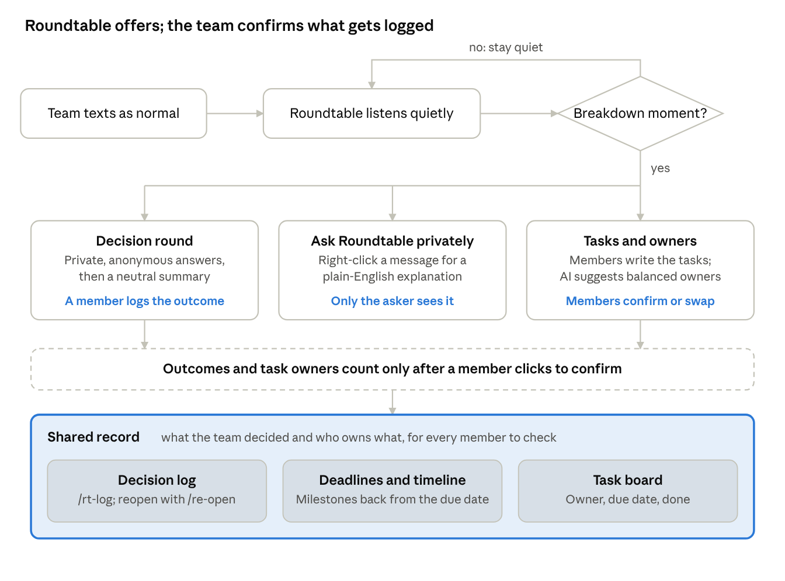

<!--
Snapshot of the team's live Claude Docs proposal, exported 2026-10-23 after it was
updated to match the built Discord bot. The live doc is the source of truth:
https://claude.ai/artifact/RcEJcmjUwNajd6VGY1xY3Y
The embedded diagram is saved beside this file as how-roundtable-works.png.
-->

# Roundtable: AI Facilitator for Team Chats

Case competition proposal · Oct 20, 2026 · @Hosung

## Summary

We propose **Roundtable**, an AI facilitator that joins a team's existing group chat and helps the team think together instead of handing its thinking to AI. Teammates text as normal. Roundtable stays mostly quiet, then steps in at the moments where team chats break down: a decision that needs everyone's view, a message someone doesn't fully understand, or a task that would otherwise get lost in the scroll. What the team decides and who owns what are kept in a shared decision log and task board.

Our client is the USC Marshall MSBA community. MSBA work is team-based, many teams mix native and second-language English speakers, and AI is now the default shortcut when a team gets stuck. Roundtable uses AI to strengthen collaboration rather than replace it, which sets us apart from pitches that automate a task.

**Pitch line:** every team has someone who quietly turns five opinions into one plan. Roundtable does that job neutrally, so nobody has to, and everybody's view counts.

**What we're submitting:** a validated problem, a working MVP (a Discord bot) built around private, anonymous decision rounds, a decision log and a task board with confirmed owners, Voice of the Customer results from a pilot with MSBA teams, a 60-second demo and an 8-minute briefing.

## The problem

Team chats are where student teamwork happens, and where it quietly breaks down. When the chat stops working, members retreat into solo AI use and paste the results together. Heavy AI use is the visible symptom. The root causes are social and structural.

| Symptom we observe | Likely root cause |
| --- | --- |
| Each member prompts AI alone; the deliverable is stitched-together AI output | No lightweight structure for reasoning together under time pressure |
| The first answer posted becomes the team's answer | Disagreeing feels socially risky; asking AI avoids conflict |
| Quieter members, often second-language speakers, drop out of the discussion | Uneven voice: the fastest typist or prompter dominates |
| "I thought you meant…" moments, missed tasks, unanswered questions | Tone and intent get lost in text; asks are vague; decisions get buried in the scroll |
| Nobody can explain or defend the final reasoning | Low ownership because the thinking was never shared |

**Problem statement:** MSBA project teams coordinate in group chats where tone gets misread, questions go unanswered, quieter members drop out, and decisions are made by whoever posts first. Collective thinking breaks down, so members fall back on individual AI outputs. The result is shallow work nobody fully owns, and lost learning in a program built on teamwork.

**Why it's worth solving:** teamwork is a core MSBA learning outcome and what employers hire for. Every group assignment repeats the problem, so the pain is frequent. As AI tools get better, the pull toward AI-first, solo work will only get stronger.

**What the research says:** in a preregistered experiment with 1,475 people in 281 five-person groups, LLM facilitation increased how much information members shared but did not significantly change the final decision ([Alsobay et al., 2025](https://arxiv.org/html/2508.08242v1)). A field experiment found individuals using AI matched the output of teams without AI ([Dell'Acqua et al., "The Cybernetic Teammate"](https://www.nber.org/papers/w33641)), so what teams uniquely add is shared judgment. A study of 25 professionals across 6 teams found collaborative AI agents could challenge groupthink and bridge communication gaps, but adoption depended on fit and on preserving people's agency ([Johnson et al., 2025](https://arxiv.org/abs/2504.14779)). We therefore claim better team process and ownership, not automatically better answers, and we keep people in charge of every decision.

### The hidden synthesis job

In every team, someone has to collect everyone's input, name the real disagreement, and propose the next step. This synthesis work is invisible, rarely credited, and tends to fall on the same conscientious member every time. Research on "non-promotable tasks" (Babcock and colleagues; *The No Club*) finds this kind of work is unevenly shared.

The synthesizer also holds the pen. Whoever summarizes decides how each view is framed and what counts as the trade-off, so even a fair-minded summary tilts toward their own view. Roundtable has no stake in the outcome: it builds the summary only from the team's own reasons, names the key trade-off, and proposes what to answer first. The team still supplies every view and makes the call.

## Who it's for

Roundtable has two audiences: students use it, and faculty or the program decide whether teams adopt it. Both need validating in our research.

**Primary persona (hypothesis, to be validated): "Priya," first-semester MSBA student.** She's on a four-person case team with members from three countries. She's technically strong but hesitant to push back in English, especially in writing. Her team's chat is busy, but decisions happen fast and she often finds out later. When the team gets stuck, someone posts an AI answer and everyone moves on.

- **Wants:** to contribute her ideas, a fair split of work and credit, fewer misunderstandings.
- **Frustrations:** being talked over in chat, vague asks, finding out about decisions late, a final deliverable she can't fully defend.
- **Current workaround:** stays quiet, does her assigned section with AI, and hopes it fits.

**Segments to test:** international vs. domestic students; teams that meet in person vs. mostly in chat; students who use AI heavily vs. lightly.

**Buyer: faculty and the MSBA program.** They want genuine collaboration and learning, not stitched AI output. If a professor assigns Roundtable for a group project, every team in that class adopts it at once. That's our go-to-market wedge.

## The product: Roundtable

Roundtable is a Discord bot the team adds to the server it already uses for chat. Teammates text as normal. The bot steps in only at a breakdown moment, and the team, not the AI, makes the call.

Most of the time Roundtable stays silent. It makes three moves: a private decision round, a private explanation of a confusing message, and owner suggestions for the team's tasks. A decision's outcome and a task's owner count only after a member clicks to confirm, and everything confirmed lands in the decision log (`/rt-log`) or the task board (`/rt-tasks list`).

**Example decision moment:** the team is split on which city to recommend for the launch. Roundtable asks before doing anything: "It sounds like you're deciding between Austin and Denver. Want me to run a quick private round so everyone's view is heard?" A member taps **Yes, run a round** (or types `/rt-decide`, with an optional deadline such as 1 day). Each member picks an option privately and adds a one-line reason, in any language; names stay hidden unless a member opts in. The channel sees only how many have answered, as progress dots, and anyone still missing gets one gentle reminder at the halfway point. When everyone has answered, the deadline passes or the starter ends it early, Roundtable posts the spread, a neutral summary of every reason that keeps the minority view, the key trade-off and one next question. Then: "The call is yours." A member clicks the outcome, the card turns green, and the decision is saved to the log.

**Tasks and owners:** after a decision, any member can press **Turn into tasks** and write a task in their own words (or use `/rt-tasks add`); the channel sees it announced. `/rt-tasks assign` suggests owners that balance everyone's load, using only task counts, due dates and each member's private preference note. Members press **Confirm**, **Swap** or **Confirm all**; nothing is assigned automatically, and unconfirmed suggestions expire after 24 hours.

**Decision log and task board:** `/rt-log` lists the channel's closed decisions with outcome, owner and date, never anyone's reasons or votes. `/re-open` revisits a past decision with a fresh vote, optionally with a new option. `/rt-tasks list` shows every task's owner, status and due date, plus open-task counts per member, with no rankings. `/rt-deadline` and `/rt-timeline` turn an assignment deadline into a proposed backward plan of milestones.

**Ask Roundtable privately:** right-click any teammate's message and choose **Ask Roundtable privately**. Only the asker sees a plain-English explanation of what it likely means, any idioms, other possible readings and a question to check. It never guesses at emotions, and nothing is posted to the channel. This helps second-language speakers follow fast chat without asking in public.

## Design principles

A bot that comments on a team's chat can damage trust as easily as build it. These rules keep Roundtable welcome in the chat.

1. **Live inside existing chats.** Roundtable is a bot added to the team's existing chat, not a new messaging app. The MVP runs in Discord; Slack and Teams can follow. Students won't move their chat, so we don't ask them to.
2. **Facilitate publicly, invite privately.** Public messages are neutral and about process. Invitations to quieter members can go privately, so nobody is singled out.
3. **Challenge ideas, never people.** Public pushback sounds like "One risk nobody has raised yet is X," never "That's wrong."
4. **Mostly quiet.** It speaks when a member uses a command. When it detects a decision it only offers a round, and one No thanks keeps it quiet for an hour. A bot that comments on everything gets muted.
5. **People think first.** At a decision, members give their own views before the AI adds anything, so the team doesn't anchor on an AI answer.
6. **AI proposes, people confirm.** Nothing becomes a confirmed decision or an assigned task because the AI inferred it. A member clicks to log every outcome and confirm every task owner.
7. **Transparent and in the team's control.** A pinned notice says what it reads and stores, every bot message is labeled AI, and any member can pause or resume it with an anonymous public notice.

## MVP scope

The MVP is built and running as a Discord bot. It centers on one hero feature, decision rounds, supported by a decision log, a task board and a private explanation tool, so what the team decides and promises doesn't get lost in the scroll. Spotting "I'll do X" commitments in chat, a catch-up digest and a contribution view are left for later.

| Feature | What it does | Status |
| --- | --- | --- |
| Decision rounds | `/rt-decide` or an accepted offer starts a round; members answer privately and anonymously with a one-line reason; the bot posts the spread, a neutral summary, the key trade-off and a next question; a member logs the outcome | Hero (built) |
| Decision detection | Reads only a short in-memory window of recent messages and offers a round when two or more people are weighing options; never starts one without a Yes | Built |
| Decision log and re-open | `/rt-log` lists outcomes, owners and dates without reasons; `/re-open` runs a fresh vote on a past decision | Built |
| Tasks and owner suggestions | Members write tasks (or Turn into tasks after a decision); AI suggests balanced owners; members Confirm, Swap or Confirm all | Built |
| Ask Roundtable privately | Right-click a message for a private, plain-English explanation; nothing is posted | Built |
| Deadlines and timeline | `/rt-deadline` saves an assignment date; `/rt-timeline` proposes 3 to 5 milestones with a buffer day | Built |
| Transparency and control | Pinned notice, AI label on every message, anonymous pause and resume, command-only mode | Built |
| Pilot stats | `/rt-stats` shows channel totals only (reply rate, time to decision, tasks on time) for our Voice of the Customer | Built |
| Commitment spotting, catch-up, contribution view | Offer "I'll do X" messages as tasks; summarize what you missed; show whose ideas shaped the answer | Later |

**Prototype:** a working Discord bot written in Python with Claude Code, an AI coding agent, and powered by Google Gemini on Vertex AI. An offline demo mode runs without any AI key, and 563 automated tests cover privacy, pause and every feature above. Open item: confirm with the organizers that a bot built with an AI coding agent meets the AI/no-code platform requirement.

## Hypothesis and validation

**Product hypothesis:** if an AI facilitator in a team's chat collects members' views independently before decisions, helps members understand each other's messages privately, and keeps decisions and tasks in a shared log and board, then (1) more members will contribute at least one original idea to the final output, (2) members will report higher psychological safety, (3) teams will report fewer misunderstandings and dropped tasks, and (4) every member can state what was decided, why, and who owns what.

Our observation that teams rely on AI instead of thinking together is a starting hypothesis. The research has to show that classmates feel this too.

**Step 2: discovery research**

- **Survey** of MSBA students (target 30+ responses): channels used for team chat, frequency of misunderstandings, how often an AI answer ends discussion, comfort voicing disagreement, willingness to let a bot read team chat.
- **Interviews** (6–8 students, 1–2 faculty). Key questions:
  - "What's the last group-chat misunderstanding on a team project, and what did it cost you?"
  - "Has a teammate's AI output become the answer without real discussion?"
  - "Have you held back a disagreement in a group project? Why?"
  - "Would you let an AI bot read your team chat? What would make you remove it?"
  - Faculty: "Would you assign a tool like this for a group project?"

**Step 5: prototype test with real teams**

- Pilot with 2–3 MSBA teams on a real assignment for about one week.
- Measure before and after with Amy Edmondson's short team psychological-safety survey, plus counts of members contributing original ideas, self-reported misunderstandings, and tasks that slipped. After each decision, ask every member to state it and its rationale on their own.
- Read the bot's own `/rt-stats` for each pilot channel: average reply share per round, median time to a logged decision, offers accepted, clarify helpfulness and tasks done on time vs. late. It shows totals only, never names or message text.
- Collect feedback, make at least one change based on it, and show the before/after in the briefing.

**Measuring the synthesis job**

- Interview question: "In your last group project, who pulled everyone's input together and proposed next steps? Was it the same person each time, and how did they feel about it?"
- Pilot metric: who did the synthesis and how long decisions took, before vs. during the pilot.

**What would change our direction:** if students say AI-first work is fine and their real pain is free-riding, we lead with the task board and owner suggestions and build the contribution view next. If most refuse to let a bot read their chat, we default to command-only mode, which already reads no ordinary chat.

## Plan by competition step

Each competition step has a concrete output we can show the judges.

| Step | What we do | Output for the judges |
| --- | --- | --- |
| 1. Find the opportunity | Segment MSBA students, map symptoms to root causes | Persona, problem statement |
| 2. Understand the user | Survey + interviews with students and faculty | Research findings, product hypothesis, why it's worth solving |
| 3. Ideate and define | Generate and prioritize features by impact; draft Lean Canvas steps 1–5 | Target concept, Lean Canvas, basic PRD |
| 4. Build the MVP | Build a Discord bot with Claude Code and Gemini: decision rounds, detection, tasks, private explanations and timelines | Working Discord bot with live AI facilitation |
| 5. Voice of the Customer | Pilot with 2–3 real teams; analyze feedback; ship at least one change | Before/after results, the change we made |
| 6. Go to market | Launch plan (professor-led adoption → whole classes → other Marshall programs); demo video; briefing | ≤ 1-minute demo video, 8-minute briefing |

**Demo video concept (60 seconds, voice-over):** a seven-person case team in Discord (Sumedha, Hosung, Ansel, Vicky, Suri, Cecilia and Aubrey) is stuck: the first answer posted is winning and two members have gone quiet. Roundtable offers a private round, everyone answers privately, progress dots fill, and the result card's neutral summary surfaces a quiet member's reason that changes the team's mind. A member logs the outcome, the decision becomes tasks with confirmed owners, and Vicky privately asks what an idiom means. It closes on the pitch line. The storyboard and production plan live in the repo at `video/PLAN.md`.

## Risks and open questions

The biggest risk is privacy: students may not let an AI read their team chat. We need numbers on this early.

| Risk | Mitigation |
| --- | --- |
| Students won't let a bot read their chat | Ask in the survey; command-only mode reads no chat; detection keeps at most 15 recent messages in memory and saves none; pinned notice; anyone can pause |
| Bot feels intrusive or judgmental and gets muted | Idea-not-person critique, private invitations for quieter members, mostly silent (Design principles) |
| AI summary or suggestion is wrong or biased | Summaries use only members' reasons and are rejected if they recommend an option; a member logs every outcome and confirms every owner |
| Students don't feel the pain we describe | Let research choose the lead pain (misunderstanding, lost commitments, free-riding or AI-first work) |
| Judges see it as anti-AI | Frame it as AI that strengthens human collaboration, not less AI |
| The build is code written by an AI agent, not a no-code tool | Confirm with the organizers early; show the AI-agent build process in the briefing |

**Open questions**

- Do most MSBA teams chat in Discord, or would Slack or WhatsApp reach more teams first?
- Would faculty assign it, and would the program endorse it?
- How do we measure "thinking together" credibly in a one-week pilot?

## Next steps

Owners are open; claim one by adding your name.

- [ ] Agree on the final direction and product name (comment on this doc)
- [ ] Draft and send the student survey; target 30+ responses
- [ ] Schedule 6–8 student interviews and 1–2 faculty conversations
- [ ] Confirm with the organizers that the prototype platform qualifies
- [ ] Recruit 2–3 teams and run the pilot on the MVP
- [ ] Make at least one product change from the pilot feedback
- [ ] Record the 60-second demo video
- [ ] Update the persona and problem statement from research findings
- [ ] Rehearse the 8-minute briefing with every member presenting a part
